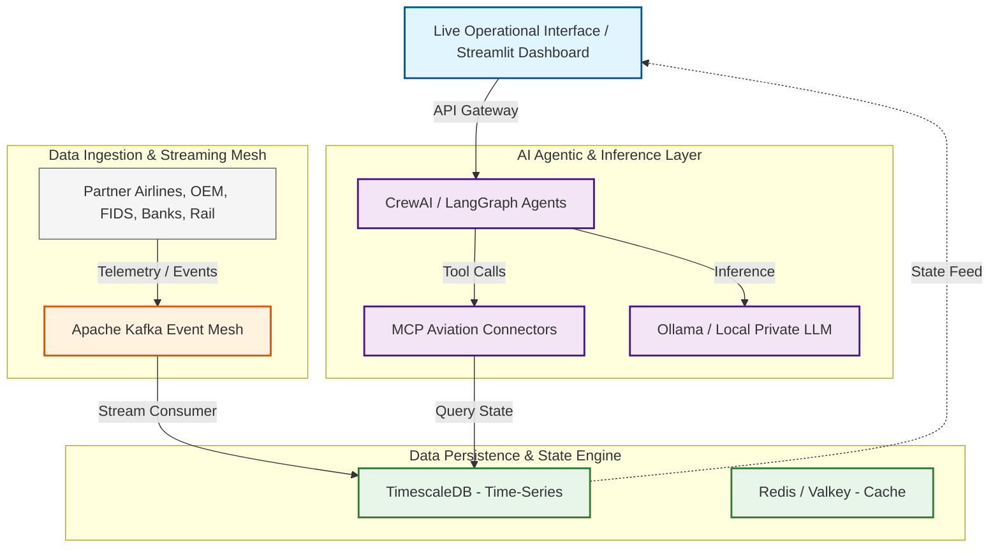

# TwinAero: Enterprise Airline Operations & Business Digital Twin

TwinAero is a 100% open-source, Docker-enabled, AI-native digital twin platform for airline operations, fleet maintenance, crew rostering, culinary logistics, and commercial ancillary services. It integrates real-time event streaming via Apache Kafka, time-series telemetry via TimescaleDB, and multi-agent AI orchestration driven by private/public LLMs through the Model Context Protocol (MCP).

---

## 🚀 High-Level Architecture & Stack

```
## 🚀 High-Level Architecture



### Core Technology Stack
* **Simulation & State Engine:** TimescaleDB (PostgreSQL) + Redis (In-memory broker).
* **Streaming Event Mesh:** Apache Kafka & ZooKeeper (ACARS telemetry, SGHA ground handling, intermodal rail, payment gateways).
* **AI Orchestration & Agentic Layer:** Python 3.12, CrewAI / LangGraph, Model Context Protocol (MCP) servers.
* **Inference Layer:** Ollama / vLLM (Private Local LLMs) with GPU pass-through + Public LLM routers.
* **Orchestration:** Docker Compose.

---

## 📁 Repository Structure

```tree
twinaero/
├── docker-compose.yml             # Full containerized stack
├── requirements.txt               # Python dependencies
├── README.md                      # Project documentation
├── data/                          # Enterprise IATA-aligned dataset (XLSX)
├── src/
│   ├── app.py                     # Streamlit / FastAPI control panel
│   ├── stream_worker.py           # Kafka event consumer & DB synchronizer
│   └── mcp_server.py              # Model Context Protocol aviation tools
└── snapshots/                     # Architecture diagrams & UI previews
```

---

## 🛠️ How to Install & Run

### Prerequisites
* Docker & Docker Compose
* NVIDIA Container Toolkit (optional, for local GPU LLM acceleration via Ollama)
* Python 3.12+

### Quick Start
1. Clone the repository:
   ```bash
   git clone https://github.com/roime81/twinaero.git
   cd twinaero
   ```

2. Spin up the entire infrastructure stack:
   ```bash
   docker-compose up --build -d
   ```

3. Verify container health:
   ```bash
   docker ps
   ```

---

## 💡 How to Use

1. **Trigger Real-Time Streams:** Send payload events to the Kafka broker topics (`aerovanguard.flight.telemetry`, `aerovanguard.finance.settlements`).
2. **Interact with AI Agents:** Query the multi-agent engine to analyze flight delays, evaluate IATA FTL crew legality, or simulate airport weather disruptions.
3. **Inspect State:** Connect to TimescaleDB (`localhost:5432`, user: `postgres`, password: `password`, db: `airlinetwin`) to explore operational records across Flight Operations, Fleet Maintenance (SGHA), Crew Roster (FTL), Culinary Catering, and Ancillary Business.

---

## 📸 Snapshots & Dashboards

> *High-level architectural dashboard preview showing real-time aircraft rotations, delay propagation, and agentic disruption handling.*
